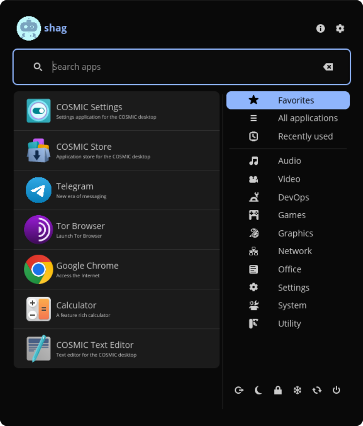
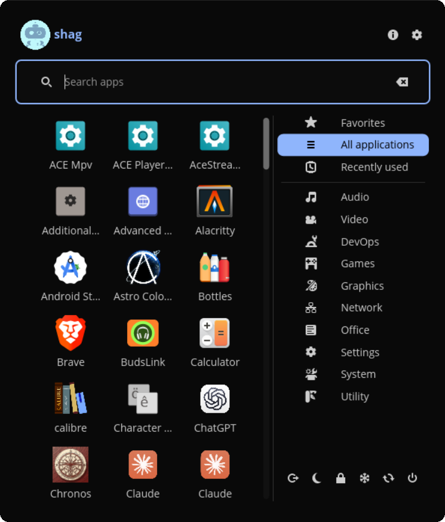
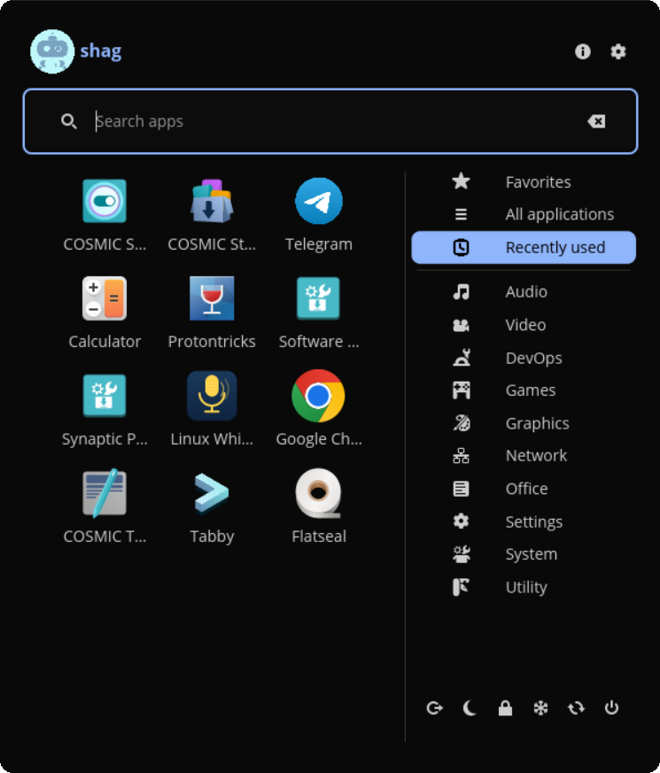
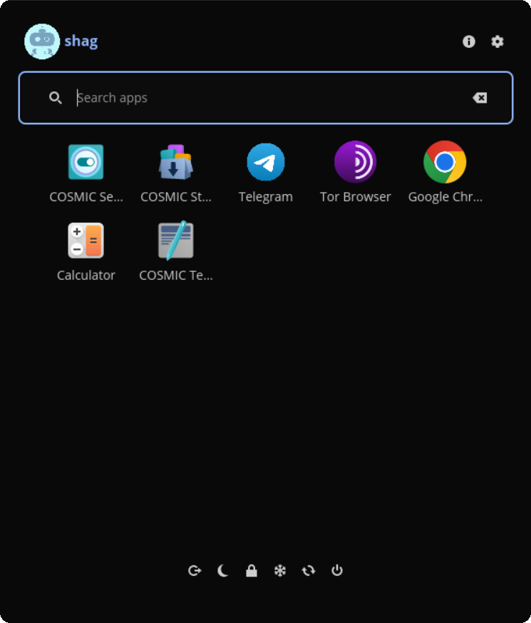
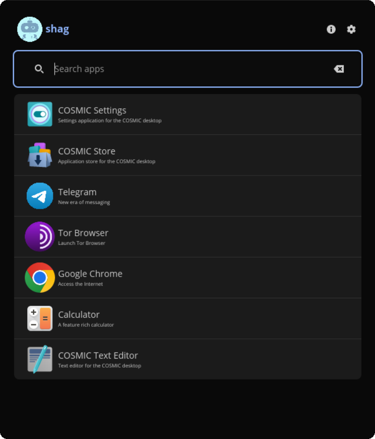
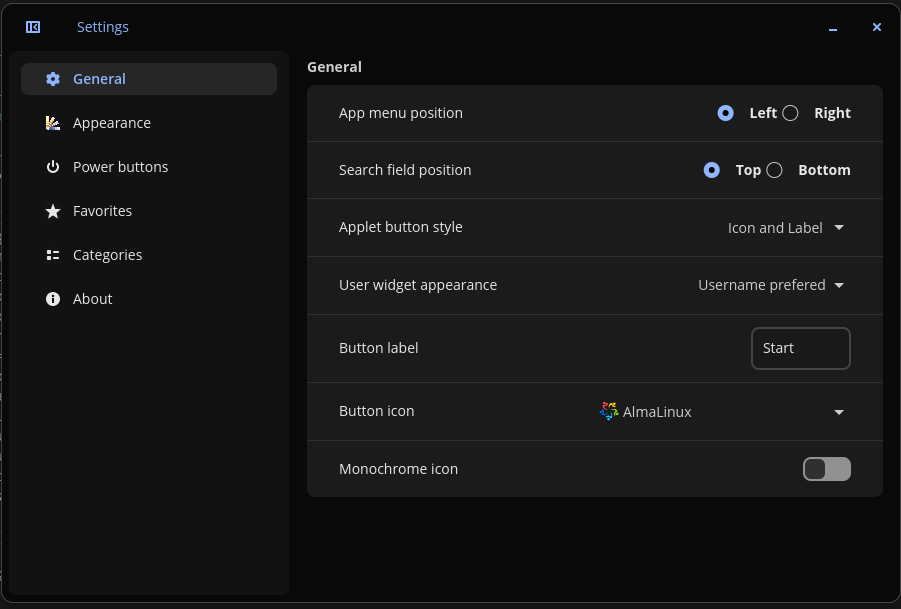
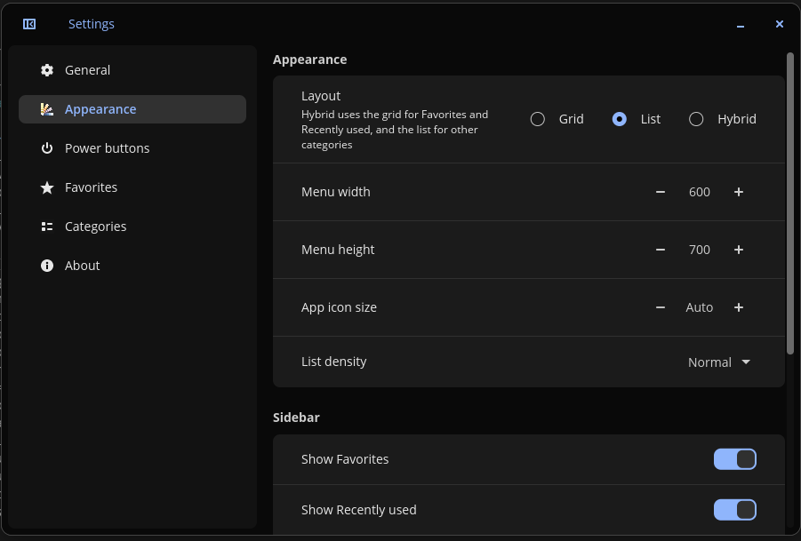
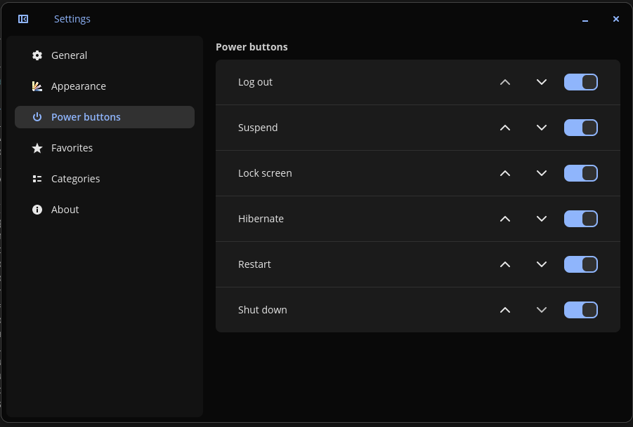
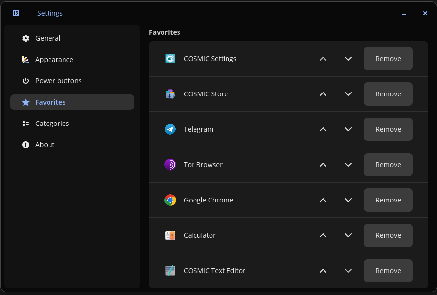
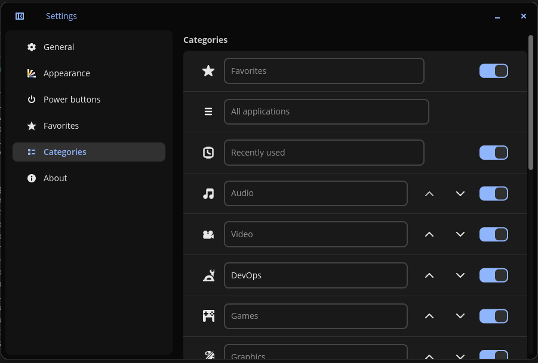

# cosmic-ext-classic-menu-plus

Classic Menu Plus is an application menu for the COSMIC™ desktop. It shows your apps by category in a list or a grid, with favorites, search, power buttons and a separate settings app.



## Features

- Grid, list and hybrid layouts. Hybrid shows Favorites and Recently used as a grid and the other categories as a list.
- Favorites: add apps from their right-click menu and reorder them in the settings
- Categories: the standard freedesktop categories and your own, each with a name and icon. Rename, reorder or hide any category, move apps between categories or hide them from the menu.
- Recently used applications
- Search by name, generic name or description, with typo tolerance
- Power buttons: log out, suspend, hibernate, lock, restart, shut down. Pick which ones to show and their order. Hibernate asks for confirmation.
- Menu size, app icon size and list density
- Panel icon chosen from a list of logos with a preview, a monochrome option, or your own file
- The sidebar and the power buttons can be hidden, and the menu can open on any category
- Pin apps to the COSMIC dock
- A settings app (`cosmic-ext-classic-menu-plus-settings`), also opened from the gear and the "i" buttons in the menu header

## Layouts

<table>
  <tr><td></td><td><strong>List</strong><br>Name and description on each row.</td></tr>
  <tr><td></td><td><strong>Grid</strong><br>App icons in a grid. Arrow keys move between cells and rows.</td></tr>
  <tr><td></td><td><strong>Hybrid</strong><br>Favorites and Recently used as a grid, other categories as a list.</td></tr>
  <tr><td></td><td><strong>Sidebar hidden</strong><br>The apps take the full width. The power buttons move under the app list.</td></tr>
  <tr><td></td><td><strong>Compact</strong><br>Sidebar and power buttons hidden.</td></tr>
</table>

## Settings

<table>
  <tr><td></td><td><strong>General</strong><br>Position of the categories and the search field, the panel button style, label and icon.</td></tr>
  <tr><td></td><td><strong>Appearance</strong><br>Layout, menu size, app icon size and list density, what the sidebar shows and the default category.</td></tr>
  <tr><td></td><td><strong>Power buttons</strong><br>Which buttons to show and in what order.</td></tr>
  <tr><td></td><td><strong>Favorites</strong><br>Reorder or remove favorites.</td></tr>
  <tr><td></td><td><strong>Categories</strong><br>Rename, reorder and hide categories, create your own, and undo hidden or moved apps.</td></tr>
</table>

### General

- **App menu position:** categories on the left or the right of the app list.
- **Search field position:** top or bottom.
- **Applet button style:** icon, label, both, or automatic by panel size.
- **User widget appearance:** user name, real name, or nothing.
- **Button label** and **Button icon:** the icon list has a preview of each logo. Its last entry opens a file chooser for your own SVG or PNG.
- **Monochrome icon:** uses the one-colour version of the selected logo when it has one.

### Appearance

- **Layout:** grid, list or hybrid. See [Layouts](#layouts).
- **Menu width**, **Menu height**, **App icon size** and **List density.**

### Sidebar

- **Show Favorites** and **Show Recently used:** include or leave out those categories.
- **Show power buttons:** turn the whole power button row on or off.
- **Hide sidebar by default:** open the menu without the categories. They still show up while moving an app to another category.

### Default menu

- **Default category:** the category the menu opens on. Automatic opens Favorites when there are any, otherwise All applications.

## Known issues

- The popup is not focused when it opens, so the search field and arrow keys may not work until you click it.

## Installation

### From the COSMIC Flatpak repository

```bash
flatpak remote-add --if-not-exists --user cosmic https://apt.pop-os.org/cosmic/cosmic.flatpakrepo
flatpak install --user cosmic io.github.shagovAlexei.cosmic-ext-classic-menu-plus
```

Then add Classic Menu Plus in Settings → Desktop → Panel → Configure panel applets.

### From source

Clone the repository:

```bash
git clone https://github.com/shagovAlexei/cosmic-ext-classic-menu-plus cosmic-ext-classic-menu-plus
cd cosmic-ext-classic-menu-plus
```

Build and install the project:

```bash
just build-release
sudo just install
```

## Flatpak

This project includes a Flatpak manifest at `flatpak/io.github.shagovAlexei.cosmic-ext-classic-menu-plus.json` and a `cargo-sources.json` helper. Use Flatpak and flatpak-builder to build, install, and run the app locally.

Prerequisites

- flatpak
- flatpak-builder
- Access to the runtimes referenced by the manifest (for example Flathub and/or System76's Flatpak remotes). If a runtime isn't available you may need to enable Flathub or add the appropriate remote.

Build and install (user)

From the repository root:

```bash
# build and install into the current user
flatpak-builder --install --user --force-clean build-dir flatpak/io.github.shagovAlexei.cosmic-ext-classic-menu-plus.json
```

Run without installing

```bash
# build the project and run the app inside the build sandbox
flatpak-builder --run build-dir flatpak/io.github.shagovAlexei.cosmic-ext-classic-menu-plus.json io.github.shagovAlexei.cosmic-ext-classic-menu-plus
```

Create a reusable bundle and install

```bash
# create a local flatpak repo and build the app into it
flatpak-builder --repo=repo build-dir flatpak/io.github.shagovAlexei.cosmic-ext-classic-menu-plus.json --force-clean

# create a single-file bundle
flatpak build-bundle repo io.github.shagovAlexei.cosmic-ext-classic-menu-plus.flatpak io.github.shagovAlexei.cosmic-ext-classic-menu-plus

# install the bundle for the current user
flatpak install --user io.github.shagovAlexei.cosmic-ext-classic-menu-plus.flatpak
```

Notes & troubleshooting

- If the build fails due to a missing runtime, add Flathub (or the remote that provides the runtime):

```bash
flatpak remote-add --if-not-exists flathub https://flathub.org/repo/flathub.flatpakrepo
```

- The manifest uses `com.system76.Cosmic.BaseApp` as its base. Ensure that remote provides that runtime or change the manifest to a base available to you.


## Fedora / COPR

> **Note:** this section describes the **original** upstream project (`championpeak87/cosmic-ext-classic-menu`), not the Plus fork. There is no COPR package for the fork.

A Fedora COPR package is available for the original project in the `championpeak87/cosmic-ext-classic-menu` COPR repository. Use the `dnf copr` helper to enable the COPR and install the packaged RPM.

```bash
# enable the COPR repository (requires sudo)
sudo dnf copr enable championpeak87/cosmic-ext-classic-menu -y

# install the packaged application
sudo dnf install cosmic-ext-classic-menu
```

To update the package later:

```bash
sudo dnf upgrade --refresh cosmic-ext-classic-menu
```

To remove the package and disable the COPR repo:

```bash
sudo dnf remove cosmic-ext-classic-menu
sudo dnf copr disable championpeak87/cosmic-ext-classic-menu
```

More details and package versions are available on the COPR page:

https://copr.fedorainfracloud.org/coprs/championpeak87/cosmic-ext-classic-menu/

## Contributing

A [justfile](./justfile) is included with common recipes used by other COSMIC projects:

- `just build-debug` compiles with debug profile
- `just run` builds and runs the application
- `just check` runs clippy on the project to check for linter warnings
- `just check-json` can be used by IDEs that support LSP

## License

Code is distributed with the [GPL-3.0-only license][./LICENSE]

---

A fork of [championpeak87/cosmic-ext-classic-menu](https://github.com/championpeak87/cosmic-ext-classic-menu) with extra features: favorites, custom categories, hibernate, configurable power buttons, and appearance settings (popup size, icon size, list density). It uses its own app id, config and D-Bus name, so it can be installed next to the original.

